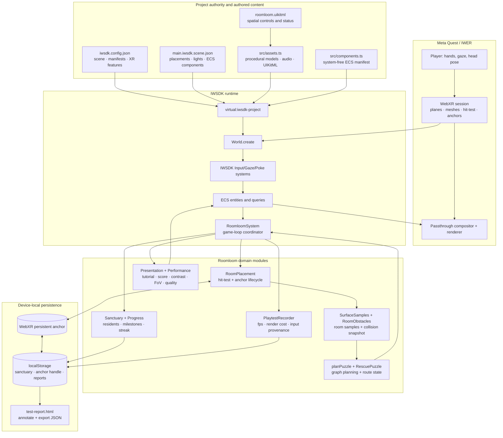
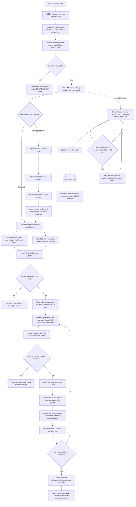

# Roomloom: The Last Firefly

**Rescue the last fireflies hiding in your room and grow a living tabletop garden, one five-minute ritual at a time.**

Roomloom is a hands-first, seated mixed-reality game built with the Immersive Web SDK (IWSDK) for the 2026 Meta VR Start Developer Competition. XR means an immersive session; IWER is IWSDK's browser-based XR emulator. The player guides three light-creatures home along routes authored by their own room — real tables, planes, walls and meshes — not by a pre-authored level. Daily rescues permanently add residents and garden milestones; each completed round ends with a gentle score, a personal best and a consecutive-day lightkeeping streak. Lumen fireflies and moon moths alternate by local calendar date.

## Submission

- **Tagline:** Rescue the last fireflies hiding in your room and grow a living tabletop garden, one five-minute ritual at a time.
- **Demo opening:** Show a bare garden in passthrough, pinch one distant light, and cut immediately to the first luminous plant growing from the real table. Complete all three rescues before explaining the technology.
- **Track / Division:** Gaming / New Experience. Highest prize: $100,000 Best New Gaming Experience. Rules limit an Entry to one prize, so special awards do not stack.
- **Test URL:** [https://mimimoneydev.github.io/roomloom-the-last-firefly/](https://mimimoneydev.github.io/roomloom-the-last-firefly/) — open in Meta Quest Browser, allow hand tracking and scene/space permissions, then enter the immersive AR session.
- **Competition deadline:** November 18, 2026 at 12:00 PM Pacific Time. The submitted build must then remain free and unchanged through the winner announcement, expected on or around December 11, 2026.
- **Target public launch:** March 2027 (confirmed).
- **Submission copy:** [`SUBMISSION.md`](SUBMISSION.md) is the working source for Devpost copy; private owner identity, account and media-link values are retained in the completed submission records rather than repeated in this public README.
- **Verification status:** Owner eligibility, account access, licensing, division, video, screenshots and physical-device checks have been confirmed. [`REMEDIATION.md`](REMEDIATION.md) remains the historical implementation and verification plan.

### Competition compliance snapshot

This table maps the verified build to the [competition requirements](https://start-developer-competition-26.devpost.com/) and [official rules](https://start-developer-competition-26.devpost.com/rules). Private identity, account and device-report details are intentionally not reproduced in this public README.

| Requirement | Roomloom evidence | Status |
| --- | --- | --- |
| Meta VR app in an eligible track | IWSDK/WebXR mixed-reality game for Meta Quest; submitted as **Gaming** | Implemented |
| Correct division | Conceived and built during the competition window; submitted as **New Experience** | Verified |
| Hands-first, end-to-end | Hand-ray point-and-pinch, near-poke, gaze-and-pinch fallback, pinch-and-hold placement, and `?hands=1` controller rejection with input-provenance telemetry | Verified on physical Quest with controllers unpaired |
| Seated and stationary | No locomotion; all essential interactions target a two-foot seated radius; panel distance adapts to field of view (FoV) | Verified with unfamiliar users |
| Satisfying in ten minutes or less | Five-minute, three-rescue round; fast room-scan gate, three-step tutorial, pause/resume and non-punitive completion | Implemented |
| Purposeful passthrough | Real planes, walls and meshes author puzzle positions and routes; no automatic playable floating fallback | Implemented |
| Original, not a wrapper | Project-owned procedural creatures, garden, room reasoning, interaction, progression, telemetry and presentation; no external service is required for the core loop | Implemented |
| Reliable IWSDK build link | Public HTTPS GitHub Pages build with CI-backed typecheck, tests and build | Verified in Quest Browser |
| Free and available through judging | Public URL requires no payment or account | Verified; availability monitoring continues through judging |
| Demonstration video | Public YouTube/Vimeo video under three minutes showing real hands-only Quest gameplay | Complete and owner-confirmed |
| Complete form | Name, ≤140-character tagline, track, division, inspiration, build details, future plans, launch date, team contacts and hands notes | Complete and owner-confirmed |
| English, rights and policy compliance | In-app and submission materials are English; assets are procedural or repository-owned | Eligibility, licenses and policy review confirmed |

### Judging-criteria coverage

The four Stage Two criteria are equally weighted at 25% each.

| Criterion | What the current build demonstrates | Final verification |
| --- | --- | --- |
| Innovation & Creativity | A real room becomes the puzzle graph; vertical walls, tables, planes and meshes can change the solution; the garden grows across daily visits | Verified in real-device footage from different rooms |
| Experience Design | Hands-first onboarding, seated play, free undo, no fail state, high contrast, FoV-aware UI, pause/recovery and a five-minute return loop | Five unfamiliar-user field tests completed |
| Technical Implementation | Scene understanding, hit-test placement, persistent anchors, obstacle-checked arcs, granted-capability reporting, adaptive quality and ECS-driven interaction | Physical Quest hands-only and performance acceptance checks passed |
| Polish & Presentation | Procedural art, positional cues, ambient audio, cohesive spatial panel, score/grade summary and persistent sanctuary milestones | Final real-device screenshots and sub-three-minute trailer completed |

### Final submission gate

- [x] Representative eligibility, active Meta developer account, Meta VR Start membership and one-entry limit confirmed.
- [x] Team details, target launch date, licensing and policy compliance confirmed.
- [x] Five physical-Quest field tests completed, including controller-unpaired hands-only completion and performance measurement.
- [x] Live URL tested from a clean Quest Browser profile and confirmed free to access.
- [x] Public YouTube or Vimeo demonstration under three minutes completed with real gameplay.
- [x] Devpost form completed in English before **November 18, 2026 at 12:00 PM PT**.
- [x] Judging build selected and post-deadline freeze/availability plan confirmed; availability monitoring continues through the winner announcement.

## Why this can win

- **Passthrough has a job:** a cold start refuses to play until a real surface is found. The room's planes and meshes become the puzzle topology, and every flight is checked against real geometry. There is no playable floating default that behaves the same with passthrough off.
- **Hands first, end-to-end:** hand-ray point and pinch, near-poke, and a pinch-and-hold placement confirm; gaze-and-pinch is a tuned fallback where eye tracking exists. `?hands=1` refuses controller-originated selections, and telemetry records input-source provenance so a hands-only session can be proven rather than asserted.
- **Immediate interaction:** one pinch to offer the first light a home, a payoff in under two minutes, and a three-step diegetic tutorial (look → pinch → arrival) that teaches without controller terminology.
- **Holds up in untested rooms:** horizontal planes, vertical walls, mesh triangles and obstacle-checked arcs produce branch, chain and one-to-three-light routes with different *solutions*, not just different positions. Surface sources (`table` / `plane` / `wall` / `mesh`) are recorded in the field-test report.
- **Return loop:** saved residents, score, personal best, garden milestones, tomorrow's species and a daily streak reward coming back.
- **Accessibility and comfort by default:** stationary seated play, targets larger than their visual mesh, a full high-contrast UI with shape/label cues and larger type, generous target sizes, no fail state, and a panel distance derived from the camera's field of view.
- **Not a wrapper:** the procedural creatures, garden, progression, room reasoning, interaction, telemetry and rendering are project-owned.

## System architecture

`iwsdk.config.json` is the authority for the active scene, asset/component manifests and requested world features. At startup, IWSDK exposes that configuration through the virtual `virtual:iwsdk-project` module; `src/index.ts` passes it unchanged to `World.create()` and registers one application system.

XR means the live immersive session. IWER is IWSDK's browser-based XR emulator. ECS means the entity-component system: scene objects gain data components, and systems query matching entities instead of maintaining parallel object lists. A controller or hand **target ray** is the pointing line used for distant selection; a **grip pose** is the tracked hand/controller transform used for holding an object. Roomloom uses target-ray selection and fingertip near-poke, not grip-based grabbing. See Meta's [hands and eyes interaction guide](https://developers.meta.com/vr/essentials/getting-started-with-hands-and-eyes/) and IWSDK's [testing guide](https://iwsdk.dev/guides/02-testing-experience.html).



The manifest and scene are deliberately data-only across the editor/runtime boundary: static procedural geometry is built in TypeScript, while scene JSON composes only stable manifest IDs. `RoomloomSystem` is the sole project system; focused modules own room placement, puzzle planning, persistence, presentation, input evidence and performance measurement.

## Detailed data flow



Important boundaries:

- Requested XR features are not assumed to exist. The runtime reports granted hands, gaze, surface, hit-test and anchor capabilities and blocks room placement when essential data is unavailable.
- Room geometry is sampled once for a plan. Missing poses, incomplete obstacle geometry and oversized snapshots fail closed; they do not become a supposedly safe route.
- Gameplay progress, anchor restoration and test evidence are separate. A lost anchor never deletes residents, and a saved report never claims the device was physical without tester notes.
- Telemetry stays on the device. The app stores at most ten local reports; `test-report.html` is the explicit review/export path.

## Run it

Requirements: Node.js 20.19+, 22.12+, or 24+ and a modern browser. A Quest is optional for local development because IWSDK includes IWER, its browser-based XR emulator. `iwsdk.config.json` — not `vite.config.ts` — is the project authority for the active scene, assets, components and XR features.

```sh
npm ci
npm run typecheck
npm test
npm run dev
```

`npm run dev` starts the CLI-managed dev server and a managed browser at `https://localhost:8081/`. Open the managed Runtime view and enter XR (an immersive session). See [Testing Your Experience](https://iwsdk.dev/guides/02-testing-experience.html) for IWER and headset testing. To open the same build on a headset on the same Wi-Fi network, use the network URL from `npm run dev:status` and accept the expected local certificate warning.

```sh
npm run build
npm run preview
```

The deployable static build is written to `dist/`; `vite.config.ts` sets `base: './'` so it also works under a GitHub Pages subpath.

## Deploy

**Judge and test URL:** [https://mimimoneydev.github.io/roomloom-the-last-firefly/](https://mimimoneydev.github.io/roomloom-the-last-firefly/) (HTTPS enforced; deploy run green; desktop and physical Quest Browser smoke tests complete).

For instrumented physical-device regression testing, append `?test=1&hands=1`. This enables local measurement capture and rejects controller-originated selections; the normal judge URL above remains the clean entry point.

[`.github/workflows/deploy.yml`](.github/workflows/deploy.yml) builds `dist/` from a clean `npm ci`, runs typecheck and tests, and publishes to GitHub Pages on every push to `main` (also available as a manual workflow run). The workflow asks `actions/configure-pages@v5` to enable Pages (`enablement: true`). GitHub's Actions token could not create the Pages site on this repo ("Resource not accessible by integration"), so Pages was enabled **once** with the authenticated GitHub CLI (`gh api -X POST repos/mimimoneydev/roomloom-the-last-firefly/pages -f build_type=workflow`); the equivalent UI step is **Settings → Pages → Build and deployment → Source = GitHub Actions**. Once that one-time step is done, every run configures and deploys successfully. WebXR requires a secure context; Pages serves over HTTPS. Keep the public URL live and unchanged until the Winner Announcement (on or around December 11, 2026).

## Play and return

- **Cold start is a room scan**, not a level. The panel reads "Waiting for a real surface". Choose **Place in room**, look at a clear table, floor or wall until the garden preview appears, then **hold a pinch** (~0.4 s) to plant it. A short tap cannot plant the garden. If hit-test or scene understanding is unavailable, the game says so explicitly.
- **Preview (no room)** is an explicitly labelled, opt-in `PREVIEW ONLY` demo for permission-denied devices. It never starts automatically and is not the mixed-reality experience.
- Measured samples come from horizontal planes, vertical walls and room meshes, each labelled with its semantic source. `planPuzzle()` derives the round's resting places and lantern sockets from those samples and from verified clear flight arcs, so a different room produces a different solution: two lantern branches, a chain, or a one-to-three-light route. If no verified route exists, the game asks you to look at a clear table or wall and place again.
- **Lantern A / B** chooses a branch; select a light to try its route; **Undo move** is free and moves are disabled while a light is flying. Every measured flight is checked along its animated arc against a snapshot of available room meshes and planes with a conservative 10 cm clearance envelope. Missing, untracked or oversized geometry never counts as a verified clear path. Unscanned objects or furniture moved after placement are not detected: re-place the garden to rescan. Plane-only coverage is less complete than a detailed room mesh. See [IWSDK scene understanding](https://iwsdk.dev/guides/11-scene-understanding.html).
- A short guided tutorial teaches **look → pinch → arrival**; **Skip guide** and **Replay guide** are available. Waiting too long only dims a light's glow — it recovers as soon as you act, and there is no fail state. The round ends with a score (fewer hops, moves and undos, faster completion), a saved personal best, residents, streak and tomorrow's species.
- **High contrast** recolours every text element, buttons and card to a near-black / near-white palette, adds larger type and redundant shape prefixes. **Pause** freezes flights. Browser interruptions, session interruptions and tracking loss suspend interaction; recovery resumes the journey.
- Positional audio cues are emitted from the light, socket or garden that caused them (the cue entity is moved to the source's world position before playback), with a soft non-positional ambient bed. Frame time, one-second FPS windows, draw calls, triangles, geometries, textures and the active adaptive-quality tier are recorded in the instrumented build; the renderer steps down through three tiers if two consecutive one-second windows fall below 60 fps, without disabling any interaction. In immersive XR the compositor owns framebuffer scale, so pixel-ratio tuning applies only outside XR.
- The panel repositions after a sustained large head turn, and its distance is computed from `PerspectiveCamera.fov` so it also fits narrower-FoV devices. Capability reporting checks which WebXR features were actually *granted*, and shows a panel line when a required capability is missing instead of silently degrading.
- Completed rescues are saved immediately in local browser storage. Replaying the same daily slot does not farm residents. One resident welcomes a companion; three awaken a flower; six grow a grove; nine transform the garden. Returning restores residents, flowers, discoveries, best score and the next objective. The first three residents are fireflies; later rounds alternate creature families by local date, with slower, fluttering moth journeys.
- A WebXR anchor preserves garden placement when the device/browser supports persistent handles. Saved residents are independent of anchors: failed spatial restoration still preserves the sanctuary. Storage refusal is shown explicitly as session-only progress. Garden progress and high-contrast preference are local to this browser profile; clearing browser storage removes them. Persistent anchors are local to a device/browser profile, not cloud or shared-room anchors.
- `RoomloomSystem` is the only application system registered in `src/index.ts`. It owns the game loop and delegates surface/anchor lifecycle work to `RoomPlacement`. ECS (entity-component system) queries drive all interaction; Three.js is imported from `@iwsdk/core`, never from `three` directly.

## Verification

```sh
npm run typecheck
npm test                 # 32 unit tests across tests/roomloom.test.mjs and tests/competition.test.mjs
npm run build
./node_modules/.bin/iwsdk scene render-file \
  --input-json '{"path":"public/scenes/main.iwsdk.scene.json","view":"quarter","width":384,"height":384}'
git status --short      # must be clean before submission
```

The live build can be smoke-tested with `curl -I https://mimimoneydev.github.io/roomloom-the-last-firefly/` (HTTP 200 for `index.html`, the scene, UI, audio and `test-report.html`) and a headless Chromium load (0 console errors, 0 failed requests, rendered canvas). Immersive behaviour was verified separately on a physical Quest.

The scene renderer validates `public/scenes/main.iwsdk.scene.json` (including the `PokeInteractable` components and audio fields) and returns `diagnostics: []`. With the managed browser running, `iwsdk browser logs` should show no errors and `iwsdk ecs systems` should list `RoomloomSystem`, `GazeSystem` and `InputSystem` with 10 ray and 10 poke interactables. Tests cover date boundaries, corrupted/denied storage, persistent milestones, relay choices and undo, obstacle-blocked flights, measured versus preview puzzles, vertical-plane samples, input provenance, hands-only enforcement, FoV distance, quality tiers, contrast palettes, tutorial progression, score and capability reporting.

These commands prove the source, emulator and hosted bundle. The physical-device acceptance checks below separately cover immersive behaviour, hands-only completion and on-device performance.

## Physical field tests — complete

The owner confirmed completion of the physical-device protocol on Meta Quest. Private reports retain participant, room and exact performance details; this public summary records only the competition-relevant outcomes and does not expose participant information or room data.

| Verification | Outcome |
| --- | --- |
| Quest Browser launch, permissions and immersive AR entry | Pass |
| Five unfamiliar-user field tests in unfamiliar rooms | Pass |
| Entire loop with controllers physically unpaired | Pass; hands-only input provenance confirmed |
| Pinch-and-hold placement, hand ray, near-poke and gaze fallback | Pass |
| Different room geometry produces different measured routes | Pass |
| Seated two-foot-radius interaction and FoV-aware panel placement | Pass |
| Pause, interruption/tracking recovery and persistent return state | Pass |
| High contrast, onboarding, undo, completion and replay | Pass |
| One-second frame delivery against the 60 fps acceptance gate | Pass; exact samples retained in owner-held reports |
| Quest Browser public-link smoke test | Pass |

The tests used `?test=1&hands=1`: `?test=1` records frame timing, one-second FPS samples, draw calls, triangles, geometries, textures, quality tier, granted capabilities, surface sources and timestamped interactions; `&hands=1` rejects controller selections and records whether the whole session remained hands-only. Measurements exclude paused/hidden periods and long suspension gaps and represent application frame delivery rather than GPU profiling.

`test-report.html` remains the review/export path for future regression runs. Reports stay local to the browser unless explicitly downloaded; the app uploads neither room coordinates nor participant notes.
